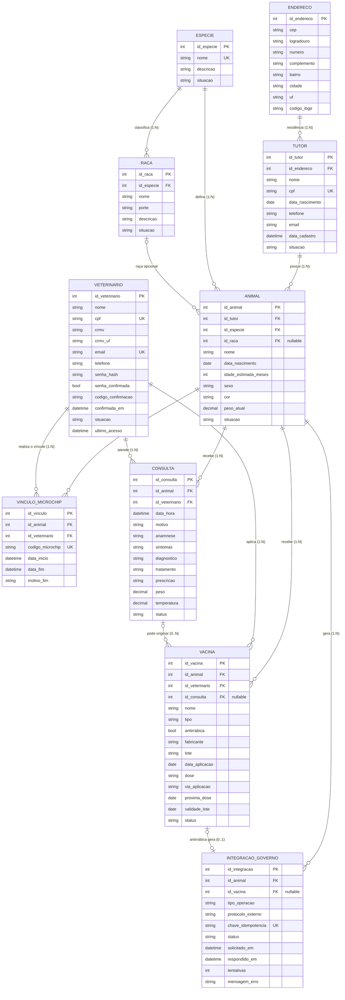

# Modelo de dados — Clínica Veterinária Garrinhas & Patinhas

Baseado no diagrama da equipe (`diagrama-er-original-v2.pdf`) e ajustado para cobrir **todos** os atributos
e regras do enunciado (seções 3, 5 e 6). O script executável está em [`database/clinica/01_schema.sql`](../../database/clinica/01_schema.sql).

## Diagrama entidade-relacionamento

## Chaves, unicidade e restrições

| Tabela | PK | FKs | Unicidade | Restrições (CHECK / índice) |
|---|---|---|---|---|
| endereco | id_endereco | — | — | `length(uf)=2` |
| tutor | id_tutor | id_endereco | **cpf** | situação ∈ {ATIVO, INATIVO} |
| especie | id_especie | — | **nome** | situação |
| raca | id_raca | id_especie | **(id_especie, nome)** | situação |
| veterinario | id_veterinario | — | **cpf**, **email**, **(crmv, crmv_uf)** | senha_confirmada ∈ {0,1}; situação |
| animal | id_animal | id_tutor (NOT NULL), id_especie, id_raca (NULL = sem raça) | — | sexo ∈ {M,F}; peso > 0; **data_nascimento OU idade_estimada** |
| vinculo_microchip | id_vinculo | id_animal, id_veterinario | **codigo_microchip** | índice único parcial: **1 microchip ativo por animal** (`data_fim IS NULL`) |
| consulta | id_consulta | id_animal, id_veterinario | — | status ∈ {AGENDADA, REALIZADA, CANCELADA, NAO_COMPARECEU} |
| vacina | id_vacina | id_animal, id_veterinario, id_consulta (NULL) | — | tipo estruturado; `antirrabica = (tipo='ANTIRRABICA')`; status ∈ {AGENDADA, APLICADA, CANCELADA} |
| integracao_governo | id_integracao | id_animal, id_vacina (NULL) | **chave_idempotencia** | tipo_operacao; status ∈ {PENDENTE, ENVIADA, CONFIRMADA, FALHA} |

## O que foi ajustado em relação ao diagrama original (v2)

O diagrama da equipe estava correto na estrutura geral. Para atender ao enunciado, foram acrescentados/corrigidos:

| Entidade | Ajuste | Motivo (enunciado) |
|---|---|---|
| **Veterinário** | + `cpf`, `crmv_uf`, `senha_hash`, `senha_confirmada`, `codigo_confirmacao`, `confirmada_em`, `situacao`, `ultimo_acesso`, `data_cadastro` | 3.1 e 3.6: login, hash, confirmação, bloqueio de inativos |
| **Tutor** | + `data_nascimento`, `situacao` | 3.2: inativar tutor |
| **Endereço** | + `codigo_ibge` | 3.3 |
| **Espécie / Raça** | + `situacao` (ambas), `descricao` (raça) | 3.4 e 3.5 |
| **Animal** | + `id_especie` (e `id_raca` agora **nullable**), `cor`, `idade_estimada_meses`, `situacao` | 3.5/3.7: "sem raça definida" não pode perder a espécie |
| **Consulta** | + `anamnese`, `sintomas`, `tratamento`, `peso`, `temperatura`, `observacoes` | 3.8 |
| **Vacina** | + `tipo`, `antirrabica`, `via_aplicacao`, `dose`, `validade_lote`, `status`; `id_consulta` opcional | 3.9: classificação estruturada da antirrábica |
| **Integração_Governo** | FK `id_consulta` → **`id_vacina`**; + `tentativas`, `mensagem_erro`, `tipo_operacao` (substitui `servico`) | Seção 5: vínculo com a aplicação de vacina e controle de tentativas |
| **Vínculo_Microchip** | `codigo_microchip` UNIQUE + índice parcial do chip ativo | 3.7: unicidade e histórico na substituição |

> ✏️ **A fazer pela equipe:** atualizar o diagrama visual (PDF/imagem) com estes ajustes e salvá-lo nesta pasta.
> O diagrama Mermaid acima já serve como entrega (o GitHub o renderiza).
