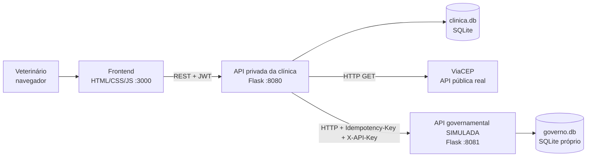

# Requisitos e arquitetura

## 1. Visão geral
Sistema web para uma clínica veterinária fictícia (**Garrinhas & Patinhas**), composto por três serviços independentes
que se comunicam por HTTP/REST + JSON.

### Camadas da API privada (`backend-clinica/`)
| Arquivo | Responsabilidade |
|---|---|
| `app.py` | Rotas REST, validação de entrada e regras de negócio |
| `security.py` | Hash de senha (scrypt), JWT, proteção de endpoints, autorização |
| `db.py` | Acesso ao banco relacional |
| `validators.py` | CPF, e-mail, data, microchip |
| `viacep.py` | Cliente da API pública (CEP inexistente, timeout, indisponibilidade) |
| `integracao.py` | Cliente do governo: estados, tentativas, idempotência, reenvio automático |
| `config.py` | Configuração por variáveis de ambiente |

### Decisões tecnológicas (justificativa exigida pelo enunciado)
| Item | Escolha | Justificativa |
|---|---|---|
| Backend | Python + Flask | Simples, legível, ótimo para APIs REST didáticas |
| Banco | SQLite (relacional) | Zero instalação; atende "ou equivalente"; DDL portável para PostgreSQL/MySQL |
| Autenticação | JWT (HS256) + scrypt | Stateless; logout via lista de tokens revogados |
| Frontend | HTML/CSS/JS puro | Sem build; responsivo; consome só a API REST |
| Docs/testes | OpenAPI + Postman + script `run_tests.py` | Reprodutível |

## 2. Requisitos funcionais (resumo → onde estão implementados)
| Seção | Requisito | Implementação |
|---|---|---|
| 3.1 | Login, hash, confirmação por código, bloqueios, logout, endpoints protegidos | `/api/auth/*`, `@auth_required` |
| 3.2 | CRUD lógico de tutores, CPF válido e único; perfil completo e edição | `/api/tutores`, tela de perfil do tutor |
| 3.3 | Endereço + ViaCEP com fallback manual | `/api/cep/{cep}` + formulário |
| 3.4/3.5 | Espécies e raças (compatibilidade, "sem raça") | `/api/especies`, `/api/racas`, validação em `/api/animais` |
| 3.6 | Veterinários (CRMV, hash, confirmação, último acesso) | `/api/auth/cadastro`, tabela `veterinario` |
| 3.7 | Animais + microchip único, histórico na substituição | `/api/animais`, `/api/animais/{id}/microchip` |
| 3.8 | Consultas e histórico | `/api/consultas`, `/api/animais/{id}/consultas` |
| 3.9 | Vacinas, próximas doses, antirrábica estruturada | `/api/vacinas`, `/api/animais/{id}/vacinas` |
| 3.10 | API privada REST | `backend-clinica/` |
| 3.11 | API governamental simulada | `api-governo-simulada/` |
| 4 / 5 | Comunicação obrigatória da antirrábica + controle de integrações | `integracao.py`, `/api/integracoes` |

## 3. Regras de negócio da vacina antirrábica
1. Registro **local primeiro** (commit) → só depois a comunicação.
2. Só gera comunicação se `tipo = ANTIRRABICA` **e** `status = APLICADA`.
3. Exige microchip ativo (é o identificador enviado ao governo).
4. Chave de idempotência **fixa** (`VACINA_ANTIRRABICA-{id_vacina}`): reenviar nunca duplica no governo
   (que também barra duplicidade por `microchip + data + lote`).
5. Estados: `PENDENTE` (indisponível/timeout, aguardando reenvio) → `ENVIADA` (em trânsito) → `CONFIRMADA` (protocolo recebido) ou `FALHA` (rejeitada 4xx ou limite de tentativas).
6. Reenvio **automático** (thread a cada 30 s) e **manual** (`POST /api/integracoes/{id}/reenviar`, `/reprocessar-pendentes`).
7. A tela distingue "vacina registrada" (local) de "confirmada pelo governo" (protocolo).

## 4. Requisitos não funcionais
Interface responsiva ✔ · REST frontend↔backend ✔ · banco relacional ✔ · validação no frontend (atributos HTML) e backend ✔ ·
tratamento de HTTP/timeout/indisponibilidade ✔ · autenticação/autorização ✔ · senhas com hash ✔ · registro das integrações ✔ ·
documentação OpenAPI ✔ · código em camadas ✔ · dados fictícios ✔.

## 5. Limitações conhecidas
- E-mail de confirmação é **simulado** (código devolvido na resposta e impresso no console), conforme permitido.
- Perfis de autorização: todo veterinário ativo e confirmado tem o mesmo nível de acesso.
- A API governamental é **fictícia** e não representa integração oficial.
