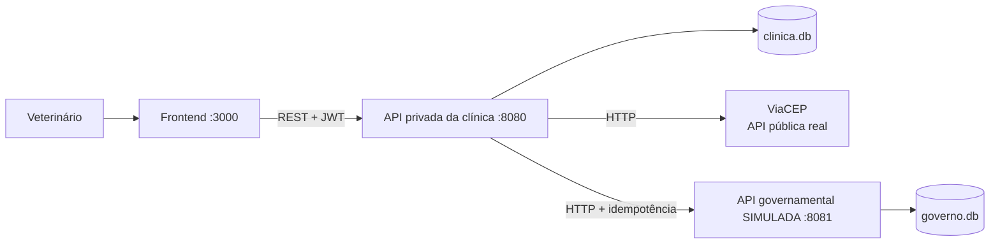

# 🐾 Garrinhas & Patinhas — Sistema Web para Gestão de Clínica Veterinária com Integração de APIs

> **A3 – Projeto Integrador · Sistemas Distribuídos e Mobile (SDM)** · IBMR Centro Universitário Barra
> Entrega/Apresentação: **26/11/2026** · Cronograma: [`docs/cronograma.jpeg`](Garrinhas-Patinhas.SDM/docs/cronograma.jpeg) ·

Sistema web para cadastro e atendimento de uma clínica veterinária (**dados fictícios**): tutores, animais com microchip RFID,
veterinários, consultas e vacinas. Três serviços independentes se comunicam por HTTP/REST:



> ⚠️ A API governamental é **simulada** e **não** representa integração oficial com órgãos reais.

## ✅ O que o sistema faz
- **Login** de veterinário (hash scrypt + JWT), confirmação de senha por código (e-mail simulado), bloqueio de inativos e de senha não confirmada, logout.
- **Tutores** (CPF validado e único, inativação lógica) e **endereços** com preenchimento automático via **ViaCEP** (tratando CEP inexistente, timeout e indisponibilidade).
- **Espécies/raças** com validação de compatibilidade (e "sem raça definida").
- **Animais** com **microchip RFID** único, vínculo por veterinário autenticado e **histórico preservado** na substituição.
- **Consultas** e **vacinas** com histórico por animal e próximas doses.
- **Regra central:** toda vacina **antirrábica aplicada** é comunicada à API governamental **após** o registro local; se o governo estiver fora, a vacina fica salva, a comunicação fica **PENDENTE** e é reenviada (manual/automático) **sem duplicar** (chave de idempotência).
- Painel de **integrações** (PENDENTE → ENVIADA → CONFIRMADA | FALHA) e simulador de indisponibilidade do governo.

## 🛠️ Tecnologias
| Camada | Tecnologia |
|---|---|
| Frontend | HTML + CSS + JavaScript (responsivo, sem build) |
| API privada / API governamental | Python 3.10+ · Flask · PyJWT · requests |
| Banco de dados | SQLite (relacional; DDL portável p/ PostgreSQL/MySQL) |
| Documentação | OpenAPI 3 (`docs/api/`) |
| Testes | Postman + script `tests/run_tests.py` |

Justificativas em [`docs/requisitos/requisitos-e-arquitetura.md`](Garrinhas-Patinhas.SDM/docs/requisitos/requisitos-e-arquitetura.md).

## 🚀 Como executar

**Pré-requisitos:** Python 3.10+ e Git.

```bash
git clone https://github.com/YasmimCosta/Garrinhas-Patinhas.SDM.git
cd Garrinhas-Patinhas.SDM

python -m venv .venv
source .venv/bin/activate          
pip install -r requirements.txt

cp .env.example .env              
```

Abra **três terminais** (com o venv ativo), na raiz do projeto:

```bash
# 1) API governamental simulada  -> http://localhost:8081
cd api-governo-simulada && python app.py

# 2) API privada da clínica      -> http://localhost:8080
cd backend-clinica && python app.py

# 3) Frontend                    -> http://localhost:3000
cd frontend && python -m http.server 3000
```

Os bancos são **criados e populados automaticamente** na primeira execução a partir de
[`database/clinica/`](Garrinhas-Patinhas.SDM/database/clinica) e [`database/governo/`](Garrinhas-Patinhas.SDM/database/governo). Para recomeçar do zero, apague os arquivos `*.db`.

### Acesso de demonstração (dados fictícios)
| Veterinário | E-mail | Senha | Situação |
|---|---|---|---|
| Dra. Ana Souza | `ana.souza@clinica.test` | `Senha@123` | ✅ ativa e confirmada |
| Dr. Bruno Lima | `bruno.lima@clinica.test` | `Senha@123` | ⛔ inativo |
| Dra. Carla Dias | `carla.dias@clinica.test` | `Senha@123` | ⏳ senha não confirmada (código `123456`) |

CEP para teste: `20040020` (válido) e `99999999` (inexistente). Microchips: 15 dígitos, ex.: `076000000000001`.

## 🔌 Endpoints
Documentação completa: [`docs/api/openapi-clinica.yaml`](Garrinhas-Patinhas.SDM/docs/api/openapi-clinica.yaml) e [`docs/api/openapi-governo.yaml`](Garrinhas-Patinhas.SDM/docs/api/openapi-governo.yaml)
(cole no <https://editor.swagger.io> para visualizar).

| API privada (8080) | |
|---|---|
| `POST /api/auth/login` · `/cadastro` · `/confirmar` · `/logout` | autenticação |
| `GET /api/cep/{cep}` | consulta ViaCEP |
| `/api/tutores` (POST, GET, GET/PUT/DELETE `/{id}`) | tutores |
| `/api/animais`, `/api/animais/{id}`, `POST /api/animais/{id}/microchip` | animais e microchip |
| `POST /api/consultas`, `GET /api/animais/{id}/consultas` | consultas |
| `POST /api/vacinas`, `GET /api/animais/{id}/vacinas` | vacinas e próximas doses |
| `GET /api/integracoes`, `POST /api/integracoes/{id}/reenviar` | controle das integrações |

| API governamental simulada (8081) | |
|---|---|
| `POST /api/governo/animais` · `GET/PUT /api/governo/animais/{microchip}` | registro do animal |
| `POST /api/governo/vacinacoes-antirrabicas` | recebe vacinação antirrábica |
| `GET /api/governo/operacoes/{protocolo}` | consulta de protocolo |
| `POST /api/governo/admin/indisponibilidade` | simula `off` / `503` / `timeout` |

## 🧪 Testes
```bash
python tests/run_tests.py
```
Sobe os serviços em portas de teste com bancos temporários, executa os **16 cenários obrigatórios** (+ extras) e gera
[`docs/testes/relatorio-testes.md`](Garrinhas-Patinhas.SDM/docs/testes/relatorio-testes.md). A coleção Postman está em [`postman/`](Garrinhas-Patinhas.SDM/postman).

> Os testes automáticos usam um *mock* do ViaCEP (offline). Para testar o ViaCEP **real**, use a tela de tutores ou o Postman com internet.

## 📁 Estrutura
```
├── frontend/                 # interface web
├── backend-clinica/          # API privada (app, security, db, viacep, integracao, validators, config)
├── api-governo-simulada/     # API governamental simulada
├── database/{clinica,governo}# scripts SQL (schema + seed)
├── docs/                     # requisitos, diagramas, OpenAPI, testes, cronograma
├── postman/                  # coleção de testes
├── tests/                    # testes automatizados
├── scripts/setup-github.sh   # cria labels, milestones e issues
└── .github/                  # templates de issue e PR
```

## 🤝 Fluxo de trabalho
Branches `main` (estável) · `develop` (integração) · `feature/*`. Commits no padrão *Conventional Commits*. Detalhes em [`CONTRIBUTING.md`](CONTRIBUTING.md).
**Nunca** versione `.env` ou `*.db`.

## 📦 Entregáveis 
| Entregável | Onde |
|---|---|
| Requisitos e arquitetura | `Garrinhas-Patinhas.SDM/docs/requisitos/` |
| DER e modelo relacional | `Garrinhas-Patinhas.SDM/docs/diagramas/` |
| Código: frontend / API privada / API governamental | `Garrinhas-Patinhas.SDM/frontend/` · `Garrinhas-Patinhas.SDM/backend-clinica/` · `Garrinhas-Patinhas.SDM/api-governo-simulada/` |
| Scripts dos bancos | `Garrinhas-Patinhas.SDM/database/` |
| Documentação dos endpoints | `Garrinhas-Patinhas.SDM/docs/api/` |
| Coleção de testes | `Garrinhas-Patinhas.SDM/postman/` |
| Relatório de testes | `Garrinhas-Patinhas.SDM/docs/testes/` |
| Instruções de execução | este README |
| Apresentação | Feita dia 26/11 em aula |

## 👥 Equipe
| Nome | GitHub |
|---|---|
| _Yasmim Costa_ | [@YasmimCosta](https://github.com/YasmimCosta) |
| _Felipe Martins_ | [@fox322](https://github.com/fox322) |
| _Stella Cardoso_ | [@st3llami](https://github.com/st3llami) |


Professor(a): _Fabio Gomes_ · Licença: uso acadêmico.
